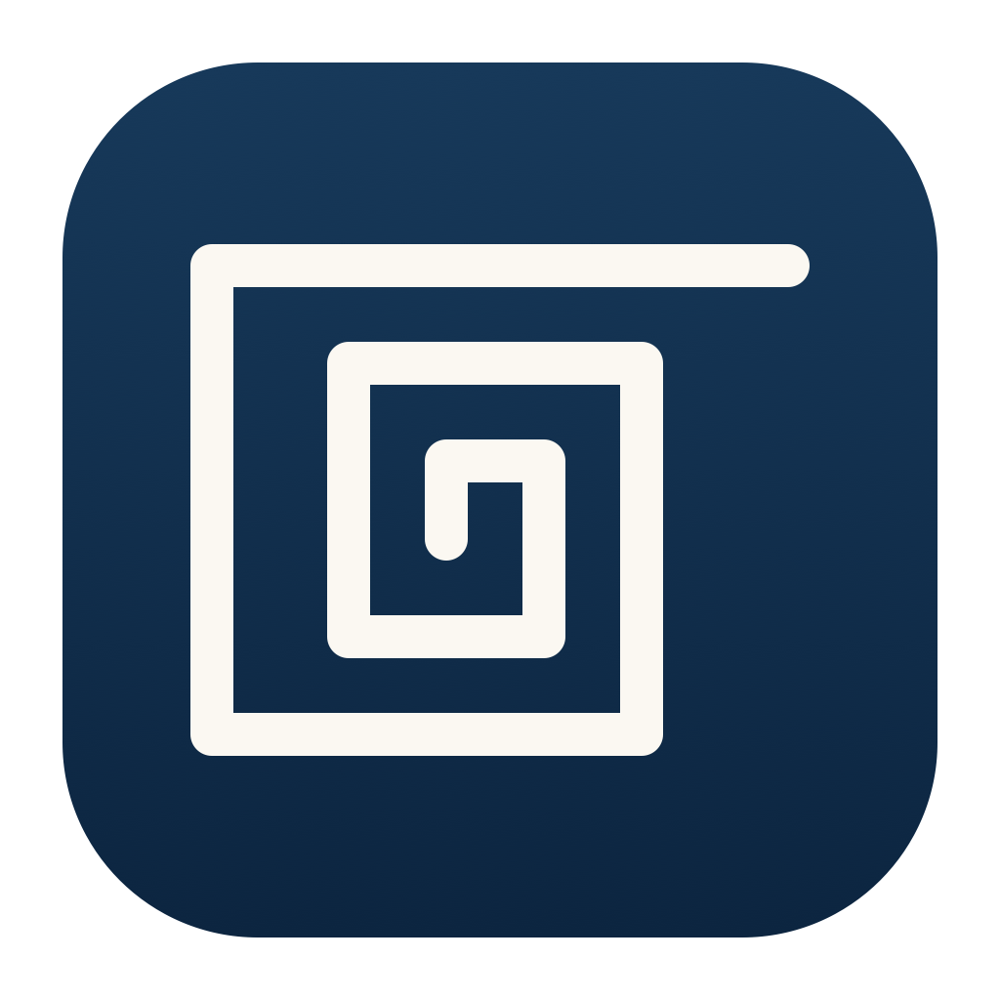

# Theseus
### Clears the path, so you can make the call.

**Free and open source, always.** No subscription, no paid tier, no data collection.

Theseus is a private personal assistant that runs in **[Claude Code](https://docs.claude.com/en/docs/claude-code/overview) on your Mac**.
It's built for people (especially ADHD brains) with *too much coming in*: texts, email, Slack, reminders, six half-finished lists in Notes,
family logistics, side projects. Theseus gathers all of it, sorts it into one prioritized list, notices what you've already handled, and
hands you clear, small decisions.

**It doesn't live your life for you. It clears the path so you can decide easily.** It never sends a message, email or Slack post on your behalf.
It drafts; you send.

Theseus has a sister app, [Ariadne](https://github.com/ExtantApe/ariadne), which files what piles up on your Mac. [The manifesto](MANIFESTO.md) is what both promise.

> Named after Claude Shannon's *Theseus* (1950), the mechanical mouse that learned its way through a maze. This one learns its way through yours.

---

## It tailors itself to you
You don't configure Theseus so much as introduce yourself to it.
- **A setup interview** asks about your work and side projects, how your days run (regimented or fluid, weekdays vs weekends), which apps
  you actually use, and how you like to be talked to. Everything goes into a plain-text **profile** you can edit anytime.
- **Give it context and it goes looking.** "I run two small businesses and a podcast" becomes categories. "My old lists are in Notes" becomes a migration.
- **It learns your writing voice** from your own sent texts (length, capitalization, emoji, how you say yes, no and later) and drafts replies that sound like you.
- **It can keep notes on a conversation, when you ask.** Deep, neutral notes on how you and one person talk catch the small patterns and get it back up to speed without rereading the whole thread. Want an outside opinion on how you come across? Ask for `/mirror`.
- **It learns how you prioritize**, from quick A-or-B questions and from what you actually do first, and turns your reasons into rules.
- **It learns your rhythm.** If you're usually up later on weekends, it notices and suggests moving your briefings.

### Lightly opinionated
Every new install starts blank: no one else's profile, priorities or voice, just templates. From your first `/theseus:setup` it gets to know
**you**, and it keeps adjusting to how you actually operate. What you finish first, what you skip, when you're up, how you write and what you
correct all become context it uses next time, and it always asks before turning a pattern into a rule.

The few things that *don't* bend are deliberate:
| Fixed | Why |
|---|---|
| **A Mac that stays on** (awake, online, signed in) | Theseus lives on your Mac, next to your Reminders, Calendar, Notes and Messages. That's what keeps it private, and it's the one real requirement. |
| **It never sends anything as you** | It clears the path; you make the call. |
| **One list, ranked** (sections are yours to add) | Lots of lists is the problem it solves. |
| **Your data stays in your workspace** | Nothing personal lives in the shared engine. |
Everything else (categories, sections, schedule, sources, tone, how big NOW gets, which check-ins it offers) is yours to shape, by telling it or
by letting it learn.

## Features

### 🫧 Bubble-sort prioritizing: "Which first?"
The feature that works best in practice. Ranking 20 things in your head is impossible. Choosing between **two** is easy:
```
Which first?  ① Renew business license (due Fri, ~15m)   or   ② Draft budget memo (no date, ~30m)
```
Answer `1`, `2`, `same` or `skip`, or give a reason ("money stuff before noon"). Theseus keeps the winner on top, bubble-sort style, but efficiently:
new items find their spot with a **binary insertion** (~4 questions for a list of 15), and a weekly pass re-checks only your top few.
**Your reasons become rules** after you confirm them, so it asks less over time. Reordering lines in your Today note counts too.

### One list, everywhere
**NOW · NEXT · LATER · EVENTUALLY · WAITING ON**, categorized and ranked, in a pinned Apple Notes note on every device. Reminders stay lean: only things
that need a ping at a time or place become Reminders. Repeating tasks ("every other Friday") are one repeating Reminder, not 26 copies.

### 📌 A pinned Today note that works offline
Your top tasks, agenda, who's waiting on you and what's due, refreshed whenever something changes. In the evening it gains a **🌙 Tomorrow** section
(agenda, top 3, what to prep tonight). Type in **✍️ Jot here** or change ☐ to x, and Theseus reads your edits back on its next run.

### It notices what you already did
Replied to that text? Sent the email? Checked off the reminder on your phone? Theseus closes the task itself, or asks "Did you already…?" when it isn't sure.

### "What's next?"
"Finished everything except the memo, waiting on Alex, I've got 45 minutes." It checks things off, parks the memo under WAITING ON with the
reason, and gives you **one** main pick plus up to two quick fillers that fit your time.

### Replies without the dread
- `/texts` shows who's waiting on you, with ❓ when they asked a question. Say "sprint" to knock out the easy ones.
- `/reply Sam` asks *you* Sam's open questions, phrased as if Sam just asked them ("Are you still coming Saturday?"), then writes the reply
  **in your words**. It never fills in blanks, and it tells you when a part of the thread is worth reading yourself.

### "Got 5 minutes?"
When things pile up (new items to rank, texts waiting for days, loose notes, stale tasks), Theseus offers **one** small, timed check-in at a
good moment: *"Got 3 min? 6 new items need a spot. A few A-or-B taps clears your NEXT backlog."* Say yes, later, not today, or never for this.
It won't ask during meetings or right before bed, and it learns when you like to tidy.

### Always reachable
Theseus keeps a Remote Control server running on your Mac, so it's never cut off: open the Claude app's **Code** tab on your phone, tap your Mac,
and start a session. Prefer texting? An optional iMessage channel lets you text yourself to reach it.

### Dictate anywhere
A Notes folder that works as your inbox, `/add …` in Claude Code, or Siri "remind me…". Optional hints ("now", "someday", "#Work", "remind me at 3",
"groceries: eggs") or none at all: it decides from context.

### Briefings on your schedule
A **morning** refresh before you wake and an **evening** look at tomorrow, per day of the week. Plus **frequent cheap checks**: a local fingerprint
every few minutes, with Claude only when something actually changed.

### Deep text tools
Neutral, timestamped **thread reports** for long or multi-year conversations, topic research across all your texts, and a check that your full message history is on your Mac.

---

## How to start
1. **Install:** `git clone https://github.com/ExtantApe/theseus && cd theseus && ./install.sh` (or install it as a Claude Code plugin, below).
2. **Introduce yourself:** run `/theseus:setup` (plugin) or follow [docs/SETUP.md](docs/SETUP.md). Answer honestly. "I'm drowning" is useful context.
3. **Migrate:** `cd ~/Theseus && claude`, then `/migrate`. Theseus gathers your reminders, old list notes and task apps, removes duplicates,
   proposes categories and drafts your list for your approval.
4. **Rank:** `/rank`. Ten quick A-or-B taps and your NOW list is in order.
5. **Schedule it:** `bash ~/Theseus/engine/install.sh --schedule`. This sets up your briefings and checks, and keeps Theseus **reachable from your
   phone**: your Mac shows up in the Claude app's Code tab (Remote Control), so you can start a Theseus session anywhere. Then pin **📌 Today** and
   **★ Master List** in Notes.

### Theseus for Mac (recommended once you're set up)
A menu bar app that keeps everything running: Remote Control, the checks and your briefings. You grant macOS permissions once, to the app, and everything it starts can use them.

It's also the nicest way to work your list: drag things into order, check them off with a few seconds to change your mind, and edit it as plain Markdown. It saves as you go, with undo. Activity shows your thread notes, and Setup lists every command.

1. Download the `.dmg` from [Releases](https://github.com/ExtantApe/theseus/releases/latest) and drag Theseus to Applications.
2. Theseus is free and isn't notarized by Apple (Apple charges for that), so macOS blocks the first launch. Allow it one of two ways:

   **Terminal (quickest):**

   ```bash
   xattr -dr com.apple.quarantine "/Applications/Theseus.app"
   ```

   **Or System Settings:** open the app and dismiss the warning, then go to **System Settings → Privacy & Security**, scroll down, and choose **Open Anyway**.

Requires macOS 14 or later, on Apple silicon or Intel, and Apple's command line tools (`xcode-select --install`).

Then open it, allow what's listed on its Setup tab, then click **Run from this app…** there. From then on it opens at login and reopens after a crash. It runs the Theseus you installed above, so do the install first.

Plugin install (inside Claude Code):
```
/plugin marketplace add ExtantApe/theseus
/plugin install theseus@theseus
/theseus:setup
```

## From Terminal
The `theseus` command works from anywhere, with the same workspace, rules and send guard as the app. The installer links it at `~/.local/bin/theseus`.

| Command | What it does |
|---|---|
| `theseus` | chat with Theseus in Terminal |
| `theseus "what's due this week?"` | ask one thing and print the answer |
| `theseus status` | your list and what's running; instant, no Claude |
| `theseus next [n]` | the top of your list; instant, no Claude |
| `theseus today` | your Today note; instant, no Claude |
| `theseus add "call the bank" [--to now]` | put something on the list, in NEXT by default; instant, no Claude, and the next sync files it properly |
| `theseus done "bank"` | check off what matches; instant, no Claude, and the next sync carries it to your other lists |
| `theseus texts` | who's waiting on a reply; instant, no Claude (Terminal needs Full Disk Access) |
| `theseus sync` · `theseus morning` | run that job now and print the result |

Only one job runs at a time. If the app or the schedule is already running one, `theseus sync` says so and stops. Anything you start from Terminal uses Terminal's macOS permissions, so Terminal needs the same access the app has.

## Commands
Inside a Claude Code session in your workspace. To see them all at a glance, run `/commands` there or `theseus help` in Terminal.

| Command | What it does |
|---|---|
| `/refresh` | full fresh re-run of everything, any time |
| `/add …` | dictate a task, reminder, event, grocery or chore in plain words |
| `/inbox` | process your Notes inbox folder now |
| `/next …` | "finished X, not Y because Z, 30 min": update, then the best next thing |
| `/rank` · `/rank now` | A-or-B prioritizing (new items, or a pass over NOW) |
| `/texts` | who's waiting on a reply; "sprint" to clear the easy ones |
| `/reply <name>` | as-if-they-asked questions, then a draft in your voice (never sent) |
| `/weekly` | weekly cleanup: archive, stale items, priority rules, rhythm |
| `/learn <name>` | deep, neutral notes on how you and this one person talk, only when you ask; reads only messages the notes haven't covered and logs every check |
| `/mirror <name>` | an unbiased outside read on how you communicate in this conversation, with dated examples, only when you ask |
| `/report <name>` | neutral, timestamped account of a long thread |
| `/research <topic>` | search and compile across your texts |
| `/history [n]` | is all your message history on this Mac? |
| `/tone` | refresh your writing-voice profile |
| `/slack [answers]` | Slack check-in (email bridge mode) |
| `/migrate` | one-time move from Reminders, Things and old notes |
| `/compliance` | re-read Anthropic's rules against how Theseus works |
| `/commands` | every command at a glance |
| `/theseus:setup` · `/theseus:doctor` · `/theseus:update` | setup interview · health check · engine update |
Plain words work too: "what's next, I have 20 minutes" is the same as `/next`.

---

## Integrations
Use only what you have. Everything except Reminders, Calendar and Notes is optional, and you can add things later.

| App / service | What Theseus does with it | How it connects | Status |
|---|---|---|---|
| [Apple Reminders](https://support.apple.com/guide/reminders/welcome/mac) | reads, creates, completes, repeats | built in (local) | ✅ core |
| [Apple Calendar](https://support.apple.com/guide/calendar/welcome/mac) | reads every synced calendar; adds events | built in (local) | ✅ core |
| [Apple Notes](https://support.apple.com/guide/notes/welcome/mac) | inbox folder, 📌 Today, ★ Master List | built in (local) | ✅ core |
| [Messages](https://support.apple.com/guide/messages/welcome/mac) (iMessage + SMS) | who's waiting, drafts, thread reports (read-only) | built in (local) | ✅ optional |
| [Contacts](https://support.apple.com/guide/contacts/welcome/mac) | names for numbers | built in (local) | ✅ with Messages |
| [Apple Mail](https://support.apple.com/guide/mail/welcome/mac) | reads every account in Mail (read-only) | built in (local) | ✅ optional |
| [Gmail](https://mail.google.com) / Google Workspace mail | reads mail, detects your replies | Composio or an MCP server | ✅ via connector |
| [Outlook](https://outlook.com) / Microsoft 365 mail | reads mail, detects your replies | Composio or an MCP server | ✅ via connector |
| [iCloud Mail](https://www.icloud.com/mail) | reads mail | Apple Mail | ✅ |
| [Google Calendar](https://calendar.google.com) | reads; adds events to the right calendar | Apple Calendar sync, **or** Composio / MCP | ✅ |
| [Outlook Calendar](https://outlook.com/calendar) | reads; adds events | Apple Calendar (Exchange), **or** Composio / MCP | ✅ |
| [iCloud Calendar](https://www.icloud.com/calendar) | reads; adds events | Apple Calendar | ✅ |
| [Slack](https://slack.com) | who needs you, check-ins (read-only) | official [Slack MCP](https://docs.slack.dev/ai/slack-mcp-server/connect-to-claude) (Claude Code sign-in), **or** the email bridge | ✅ optional |
| [ClickUp](https://clickup.com) | assignments due; project pointers | official [ClickUp MCP](https://developer.clickup.com/docs/connect-an-ai-assistant-to-clickups-mcp-server-1) | ✅ optional |
| [Skylight](https://www.ourskylight.com) | chores, groceries, to-dos, family events | community [skylight-mcp](https://github.com/chrischall/skylight-mcp) (unofficial) | ⚠️ optional, use at your own risk |
| [Things 3](https://culturedcode.com/things/) | one-time import (read-only) | built in (local database) | ✅ migration only |
| [Ariadne](https://github.com/ExtantApe/ariadne) | a separate app that files your Mac's files and Notes, with your yes; Theseus only offers it when things pile up | `ariadne` command | ✅ optional |
| iPhone alarms ([Clock](https://support.apple.com/guide/iphone/alarm-iph5a1e0c47f/ios)) | tomorrow's alarms, mismatch warnings | a Shortcut that saves them to iCloud Drive | ✅ optional |
| Apple Watch alarms | (they never leave the watch) | tell Theseus the times | ❌ not readable |
| Anything else (Notion, Todoist, Asana, Linear…) | whatever its tools allow | its MCP server or Composio toolkit, plus a line in your profile | 🧪 possible, not built in |

### MCP and Composio: two ways to connect apps (use either, or both)
- **[MCP](https://modelcontextprotocol.io) (Model Context Protocol)** is the open standard Claude Code uses to talk to other apps. Each service runs its own
  MCP server, ideally an official one (Slack and ClickUp have them). You add each one to Claude Code and sign in through that service.
  **Best when an official server exists:** one hop, the vendor's own permissions, nothing in between.
- **[Composio](https://composio.dev)** is a third-party hub that speaks MCP. You connect your accounts once in Composio (Gmail, Google Calendar,
  Outlook, Slack, Notion and 1,000+ more), and Claude Code reaches all of them through a single connection. **Best for** several accounts of the
  same kind (two Gmails plus a business Google Workspace), apps without an official MCP server, or managing everything in one place.
  The trade-off is that Composio holds your app sign-ins.
- **Together is normal:** for example, Slack and ClickUp through their official servers, and Gmail and Google Calendar through Composio. Theseus asks during setup
  which route you want for each service, and lists each account in `config.json` with a label.
- **Or skip connectors for email and calendar entirely:** add your accounts to macOS (System Settings → Internet Accounts). Apple Mail and Calendar
  then let Theseus read them locally with no third party involved.

### Slack, two ways
1. **Official Slack connector:** add Slack's MCP server to Claude Code and sign in with Slack (OAuth). Theseus reads DMs, mentions and threads that need you.
   Your workspace admin may need to approve it.
2. **Email bridge (no Slack access at all):** Slack emails you about mentions and DMs you missed. A mail rule files those emails out of sight and marks them read,
   and Theseus reads that folder and asks **"Did you get to these?"** in each briefing. Setup asks which email you use (Gmail, Google Workspace, Outlook or
   Microsoft 365, iCloud, other) and walks you through the exact filter or rule for it.

Either way, Theseus never posts to Slack.

---

## Privacy and safety
- **Your data stays in your workspace** (`~/Theseus`): profile, config, list, drafts, exports. The engine (this repo) holds no personal data, and updates never touch your files.
- Messages, Mail, Contacts and Things are read **read-only from snapshots**. A hook on every connector (`engine/tools/send_guard.py`) refuses anything that sends, in every session, and unattended runs can only read connectors and make the specific updates a sync needs. Deleting needs you. Every change Theseus makes is logged.
- Theseus runs in **your own Claude Code** and never handles your Anthropic login. A monthly check re-reads Anthropic's rules ([docs/COMPLIANCE.md](docs/COMPLIANCE.md)).

## What it costs
Theseus itself is free. You only pay for Claude, and anything that just shows you a file or changes your list from Terminal doesn't use it.

| What | Cost | Needed for |
|---|---|---|
| [Claude Pro, Max or Ultra](https://claude.com/pricing) | $20, $100 or $200 a month | Claude Code. The free Claude plan doesn't include it |
| A Mac that stays on | the one you own | Where Theseus lives |
| Apple Developer Program | not needed | Theseus isn't notarized, so you allow it once on first launch |
| [Composio](https://composio.dev) | see their pricing | Optional. Skip it if you use official connectors or Apple Mail and Calendar |

## What's next
- **Theseus for Mac, next steps:** one download with a first-run wizard in place of Terminal, drag-to-rank, and the reply questionnaire as a native form.
- **Command center:** a wall or desk display (Raspberry Pi or any monitor, landscape or portrait), wall-safe by default.
- **Voice and family (optional):** "show the family", "show my stuff", "in detail" (confirmed on your watch), and a family view for homes without Skylight.
- Plans and milestones: [docs/APP-PLAN.md](docs/APP-PLAN.md). Decisions: [docs/adr](docs/adr).

## Requirements
macOS 14+, Claude Code signed in with your own account, Apple developer tools (`xcode-select --install`). An iPhone is optional (texts, alarms).

## Contributing
Run `scripts/leak-check.sh` before every commit (`scripts/install-hooks.sh` makes it automatic). It blocks anything from your private terms list, plus phone
numbers and real-looking emails. Changes Theseus makes to its own engine on your Mac are handed back through `data/local-changes.md` (docs/SETUP.md §10a).

Questions and ideas: [open an issue](https://github.com/ExtantApe/theseus/issues).

---
**Independent project. Not affiliated with, endorsed by, or sponsored by Anthropic.** Claude and Claude Code are trademarks of Anthropic, PBC.
Skylight, ClickUp, Composio, Things, Slack, Google, Microsoft and Apple products are trademarks of their respective owners. MIT licensed. Provided as is, with no warranty.
